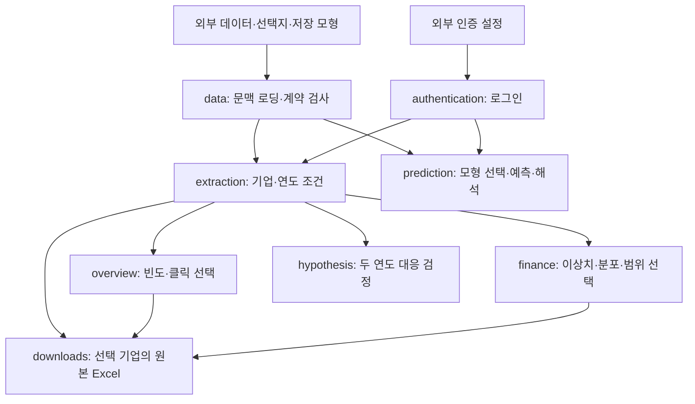

# 국내 의류산업 현황 분석 및 분석 앱

의류산업 관련 스타트업을 준비하던 수요기업의 요청으로 기업 개요·재무정보를 수집·가공하고, 코로나 전후의 재무 변화를 분석한 프로젝트다. 분석 결과를 보고서와 고객이 직접 조건을 바꾸어 탐색할 수 있는 R Shiny 앱으로 제공했다. 이 저장소는 그중 **분석 앱의 구현**을 담고 있다.

## 프로젝트와 본인의 역할

데이터바우처 사업에서 기업정보 가공, 재무 건전성 지표 구성, 머신러닝·통계검정을 이용한 분석, 고객용 Shiny 앱 개발의 핵심 실무를 주도했다. 인사이트 보고서 작성에 참여했고, 사업 종료 후에도 고객 요청 기능 추가와 버그 수정을 지원했다.

전체 업무에서는 NICE D&B 기업 개요·재무정보를 활용하고 코로나 전후 분류모형의 변수 중요도를 주요 재무지표 해석으로 연결했다.

현재 저장소에는 데이터 수집·가공 과정과 모형 학습 과정의 전체 코드, 원본 기업 데이터, 원래 저장 모형이 포함되어 있지 않다. 

## 앱의 기능


| 기능             | 업무에서의 용도                                                                                                                      |
|--------------------|---------------------------------------------------------------------------------------------------------------------------------------------|
| 데이터 추출   | 산업분류·주요사업·지역·기업 구분·종업원 수·재무연도 조건으로 기업을 찾고 결측 현황과 분포 확인 |
| 개요정보       | 주요사업·상품·매출처 등 항목별 빈도를 보고 그래프에서 선택한 기업 확인                                      |
| 재무정보       | 지표·연도·이상치 포함 여부에 따른 분포와 선택 구간의 기업 재무정보 확인                                     |
| 가설검정       | 동일 기업의 두 연도를 짝지어 기술통계와 대응표본 Wilcoxon 검정 확인                                                |
| AI 분석          | 재무지표 입력과 업종별 저장 모형으로 코로나 이전·이후 분류 확률 및 변수 중요도 확인                     |
| Excel 다운로드 | 조회·그래프 클릭·범위 선택으로 정한 기업의 원본 데이터 제공                                                      |


정보 제공에서는 확보된 연도를 유지하고 분석에서는 표본이 적었던 2016·2022년을 제외한다. 다운로드는 화면에서 선택된 기업 ID를 기준으로 원본의 모든 연도를 제공한다.

## 코드 구조



`analysis_app/app.R`가 앱을 조립하고, `ui.R`가 다섯 탭과 기존 입력 항목을 구성한다. 기능별 폴더의 `logic.R`는 데이터 계산, `server.R`는 Shiny 입력·화면 연결을 맡는다. `bootstrap.R`는 함수 정의만 읽으며 앱 실행이나 외부 자료 로딩을 시작하지 않는다.

## 실행 조건과 최소 사용법

R과 Shiny·shinymanager·dplyr·ggplot2·DT·openxlsx 등 의존성이 필요하다. 패키지 준비는 `scripts/install-dependencies.R`, 실제로 검증한 버전 목록은 `dependencies-tested.csv`를 참고한다.

실제 앱에는 기업·재무 데이터, 조회 선택지, 변수명, 저장 모형을 담은 문맥 객체와 인증 설정이 필요하다. 문맥의 필수 객체·열은 `analysis_app/data/context.R`에서 검사한다. 예전에 사용한 `context.final.RData`는 현재 보유하고 있지 않으므로 별도로 확보한 실제 자료를 준비해야 한다. 자료가 없을 때 합성 자료로 자동 전환하지 않는다.

프로젝트 루트에서 실행하는 Windows PowerShell 예시다. 경로는 본인의 비공개 자료 위치로 지정한다.

```powershell
$env:CLOTHING_CONTEXT_PATH = "C:/private/context.final.RData"  
$env:CLOTHING_CREDENTIALS_PATH = "C:/private/credentials.rds"  
Rscript --vanilla scripts/run-app.R
```

인증 RDS는 `user`, `password` 열을 갖는 데이터프레임이며 `admin`, `start`, `expire` 등 기존 인증 속성도 전달할 수 있다. 

작업 폴더에 준비된 로컬 R을 사용할 때는 `Rscript` 대신 `.\.runtime\R\app\bin\Rscript.exe`를 사용하면 된다.

 
